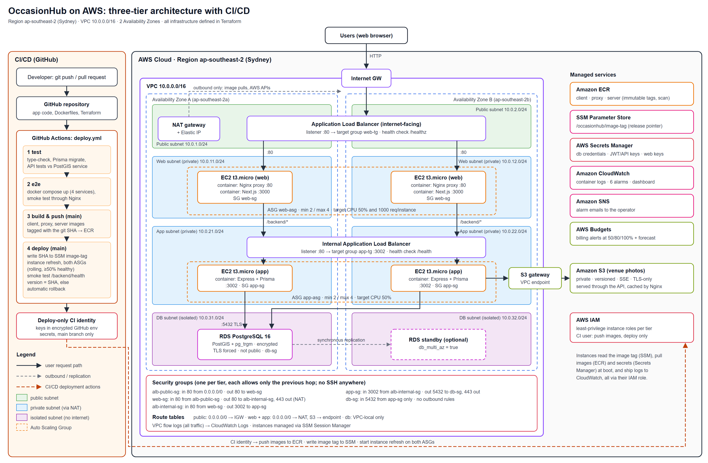

# OccasionHub on AWS: three-tier cloud deployment (SE-490 CEA)

OccasionHub (venue search, booking and negotiation) deployed as a three-tier application on AWS:

| Tier | What runs | Where |
| --- | --- | --- |
| Web | Nginx proxy + Next.js 15 (2 containers per instance) | EC2 Auto Scaling Group in private subnets, behind the public ALB |
| Application | Express + Prisma REST API (Node.js 22) | EC2 Auto Scaling Group in private subnets, behind an internal ALB |
| Database | PostgreSQL 16 + PostGIS + pg_trgm | Amazon RDS in isolated subnets (no internet route) |



Infrastructure is Terraform (`infra/terraform`). Releases go through GitHub Actions (`.github/workflows/deploy.yml`): test, end-to-end smoke test, push images to ECR, then a rolling deploy with automatic rollback. The technical report is in `report/` (LaTeX).

```
client/            Next.js front end            + Dockerfile
proxy/             Nginx web-tier proxy          + Dockerfile
server/            Express API, Prisma, tests    + Dockerfile
docker-compose.yml all tiers locally
infra/terraform/   VPC, SGs, ALBs, ASGs, RDS, ECR, S3, IAM, CloudWatch, Budgets
.github/workflows/ CI/CD pipeline
scripts/           deploy.sh (rolling deploy + rollback), bench.js (load test)
docs/              architecture diagram, benchmark results
report/            LaTeX technical report (main.tex) + figures/
```

---

## 1. Run locally (Docker Desktop)

```bash
cp .env.example .env          # set POSTGRES_PASSWORD and JWT_SECRET
docker compose up --build
```

Open http://localhost:8080. The API is under http://localhost:8080/backend/health.

Demo accounts are created by the seed script. They are demo data only.

| Role | Email | Password |
| --- | --- | --- |
| Admin | admin@occasionhub.com | admin123 |
| Vendor | vendor@occasionhub.com | vendor123 |
| User | john@example.com | user123 |

API tests (need a PostgreSQL + PostGIS database in `DATABASE_URL`):

```bash
cd server && npm ci && npx prisma migrate deploy && npm test
```

---

## 2. Deploy to AWS

> **It costs money while it runs: about $0.23 per hour in Sydney (ap-southeast-2), or about $169 a month if left on.**
> The NAT gateway and the two load balancers are billed every hour, whether anyone visits or not.
> Plan one sitting: deploy, take every screenshot, then **destroy** (step 2.7).
> Terraform also creates an AWS Budgets billing alert (step 2.3) as a safety net.

All commands below are for **PowerShell** on Windows. Open a **new** PowerShell window first, so `aws` and `terraform` are on the PATH.

### 2.1 One-time setup

1. Install the tools (skip any you already have):
   ```powershell
   winget install Hashicorp.Terraform Amazon.AWSCLI Git.Git
   ```
2. Sign in with the browser. No access keys are needed. The session lasts 12 hours and renews for up to 90 days:
   ```powershell
   aws login --region ap-southeast-2 --profile occasionhub
   ```
3. Terraform's AWS provider cannot read `aws login` sessions directly yet, so add a wrapper profile that asks the AWS CLI for them:
   ```powershell
   aws configure set region ap-southeast-2 --profile occasionhub-terraform
   # Short (8.3) path: Terraform runs this through cmd.exe, which cannot handle the space in "Program Files"
   $awsExe = (New-Object -ComObject Scripting.FileSystemObject).GetFile((Get-Command aws).Source).ShortPath
   aws configure set credential_process "$awsExe configure export-credentials --profile occasionhub --format process" --profile occasionhub-terraform
   aws sts get-caller-identity --profile occasionhub-terraform
   ```
4. Everything deploys to **ap-southeast-2 (Sydney)**, the Region of your AWS project.

> If an `aws` or `terraform` command fails with *"Could not connect to the endpoint URL"* or *"no such host"*, your network's DNS hiccupped. Run it again. Setting your Wi-Fi DNS to `8.8.8.8` fixes it for good.

### 2.2 Create the GitHub repository and push

1. On github.com, create a new **empty** repository named `occasionhub-cloud`: no README, no .gitignore, no licence.
2. In the project folder, start a fresh history and push it:
   ```powershell
   cd <project folder>
   Remove-Item -Recurse -Force .git
   git init -b main
   git config user.name  "<your name>"
   git config user.email "<your email>"
   git add -A
   git commit -m "OccasionHub three-tier deployment on AWS (SE-490 CEA)"
   git remote add origin https://github.com/<your-username>/occasionhub-cloud.git
   git push -u origin main
   ```
3. The first pipeline run tests and smoke-tests everything. The AWS jobs stay skipped until step 2.4.

### 2.3 Stage 1: registry, deploy user, billing alert (about 1 minute)

Copy `infra/terraform/terraform.tfvars.example` to `terraform.tfvars`, which is git-ignored. Set `github_repo` (`<your-username>/occasionhub-cloud`), `alert_email`, `aws_region = "ap-southeast-2"` and `aws_profile = "occasionhub-terraform"`.

The instances need images to exist before they boot, so create only the registry and the CI/CD identity first:

```powershell
cd infra/terraform
terraform init
terraform apply -target="aws_iam_user_policy.github_actions" -target="aws_iam_access_key.github_actions" -target="aws_ecr_lifecycle_policy.this" -target="aws_budgets_budget.monthly"
```

Type `yes` when asked. It should end with *Apply complete! Resources: 11 added*.

> **Terraform state holds secrets.** That includes the CI access key, the database password and the JWT key. `versions.tf` therefore stores the state **outside** the project, in a sibling folder `occasionhub-terraform-state/`. Never zip or upload that folder. Submit only the zip built from git (section 5).

### 2.4 Give the pipeline its AWS keys, then build the images

Why keys rather than OIDC: your project's AWS-managed security policy blocks IAM identity providers (`iam:*Provider*`), so keyless OIDC login cannot be set up. Instead, Terraform created a deploy-only IAM user. The pipeline can use its keys only from the `main` branch.

1. Print the two values. The second is secret: never commit it or post it anywhere:
   ```powershell
   terraform output -raw github_access_key_id
   terraform output -raw github_secret_access_key
   ```
2. In GitHub, go to **Settings ▸ Environments ▸ New environment**, name it `production`, then:
   - under **Deployment branches and tags**, choose **Selected branches and tags** and add the rule `main`;
   - under **Environment secrets**, add `AWS_ACCESS_KEY_ID` and `AWS_SECRET_ACCESS_KEY` with the two values.
3. Go to **Settings ▸ Secrets and variables ▸ Actions ▸ Variables ▸ New repository variable** and add `AWS_REGION` = `ap-southeast-2`.
4. Go to **Actions ▸ CI/CD ▸ Run workflow**.
5. The run builds and pushes the three images (about 10 minutes). The deploy job then prints *"Auto Scaling Groups not created yet. Image tag … published"*. That is expected at this stage.

### 2.5 Stage 2: everything else (about 15 minutes, mostly RDS)

```powershell
terraform apply
terraform output app_url
```

1. Type `yes` when asked.
2. AWS emails `alert_email` an SNS confirmation for the alarms. Click the link in it.
3. Add the repository variable `APP_URL` with the `app_url` value (`http://...elb.amazonaws.com`).
4. Wait 3–5 minutes for the instances to boot and pass health checks, then open the URL.

### 2.6 Show an automated deployment

1. Make a small visible change, for example a word on the landing page in `client/src/app/(nondashboard)/landing/page.tsx`.
2. Commit and push to `main`.
3. Watch **Actions**: test → e2e → build-push (×3) → deploy. The deploy job:
   - writes the new SHA to SSM;
   - rolls both Auto Scaling Groups;
   - checks that `$APP_URL/backend/health` reports the new SHA, or rolls back.
4. Note the run number and the duration of each job for the report.

### 2.7 Destroy (do not skip)

```bash
cd infra/terraform
terraform destroy
```

This deletes everything, including the database, images, photos and the CI access key. Then check **Billing ▸ Bills** the next day.

Once destroy has finished, the state no longer holds anything usable. You can delete the `occasionhub-terraform-state` folder.

---

## 3. Screenshot checklist (for the report)

Save each screenshot as PNG in `report/figures/` with exactly these names. The report picks them up automatically, and a red placeholder box shows for any that are missing.

| File | Where to take it |
| --- | --- |
| `aws-vpc-subnets.png` | VPC ▸ Subnets, filtered by `occasionhub` (8 subnets, 2 AZs) |
| `aws-route-tables.png` | VPC ▸ Route tables (public, private ×2, db) |
| `aws-ec2-instances.png` | EC2 ▸ Instances (4 running, 2 AZs, no public IP column) |
| `aws-asg.png` | EC2 ▸ Auto Scaling Groups ▸ `occasionhub-web-asg` ▸ Automatic scaling tab |
| `aws-security-groups.png` | EC2 ▸ Security Groups, filtered by `occasionhub`, with inbound rules of app-sg / db-sg |
| `aws-load-balancers.png` | EC2 ▸ Load Balancers, plus Target groups with targets *healthy* |
| `aws-rds.png` | RDS ▸ Databases ▸ `occasionhub-db` ▸ Connectivity & security (Publicly accessible: No) |
| `aws-ecr.png` | ECR ▸ `occasionhub/server` image list (SHA tags) |
| `github-actions-run.png` | GitHub ▸ Actions ▸ a green run with all 4 jobs |
| `aws-app-browser.png` | The site at the ALB URL in your browser |
| `aws-cloudwatch-dashboard.png` | CloudWatch ▸ Dashboards ▸ `occasionhub-overview` |
| `aws-budget.png` | Billing ▸ Budgets ▸ `occasionhub-monthly-budget` |

To show load balancing, open `$APP_URL/backend/health` a few times in a row. The `instance` value changes between app instances. Browser dev tools ▸ Network show the `X-Served-By` header changing between web instances.

Then fill in the red `\fillin{...}` placeholders in `report/main.tex`: repository URL, ALB URL, run number, timings, and the Pricing Calculator link.

---

## 4. Compile the report

No local TeX needed:

1. On Overleaf, choose **New Project ▸ Upload Project** and upload a zip of the `report/` folder.
2. Overleaf compiles `main.tex` with pdfLaTeX.

Locally with MiKTeX or TeX Live:

```bash
cd report && pdflatex main.tex && pdflatex main.tex
```

---

## 5. Build the submission zip

Always build the zip from git. It contains exactly the committed files: no `node_modules`, no `.env`, no `terraform.tfvars`, and no Terraform state.

```powershell
git add -A
git commit -m "Add deployment evidence"
git archive --format=zip --prefix=OccasionHub-CEA/ -o ..\OccasionHub_CEA_SE-490.zip HEAD
```

---

## 6. Troubleshooting

| Symptom | Fix |
| --- | --- |
| `AccessDenied ... iam:*Provider* ... service control policy` | Expected on new-experience projects; keep `github_auth_mode = "access_key"` (the default). Use `"oidc"` only on accounts that allow identity providers. |
| RDS error about backup retention on a Free plan account | Keep `db_backup_retention_days = 1` (the default). |
| Targets stay *unhealthy* | EC2 ▸ instance ▸ **Connect ▸ Session Manager**, then run `sudo cat /var/log/occasionhub-bootstrap.log` and `sudo docker logs server` (or `proxy`, `client`). |
| Deploy job: `set the APP_URL repository variable` | Add `APP_URL` (step 2.5). |
| Pipeline AWS jobs skipped | The `AWS_REGION` repository variable is missing. |
| `Credentials could not be loaded` in build-push | The `production` environment secrets are missing or misspelled (step 2.4). |
| Terraform: `No valid credential sources found` | Run `aws login --profile occasionhub` again (12-hour session), and check `aws_profile = "occasionhub-terraform"`. |
